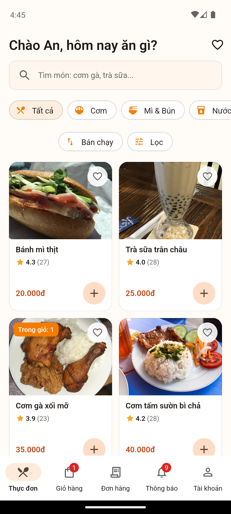
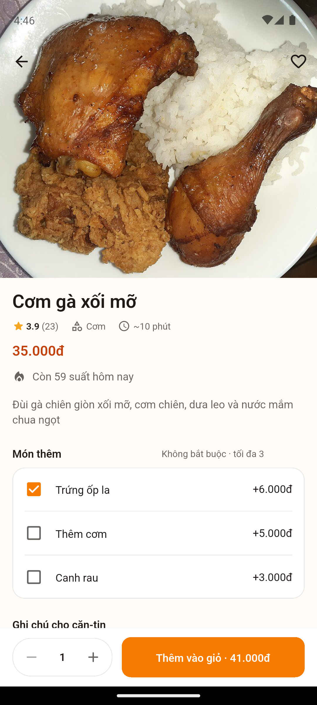
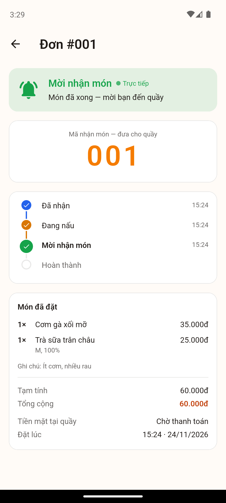
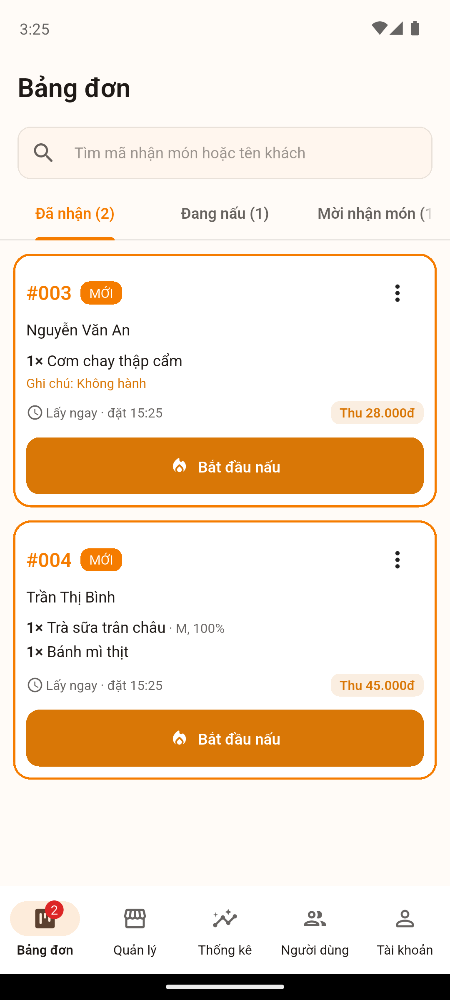
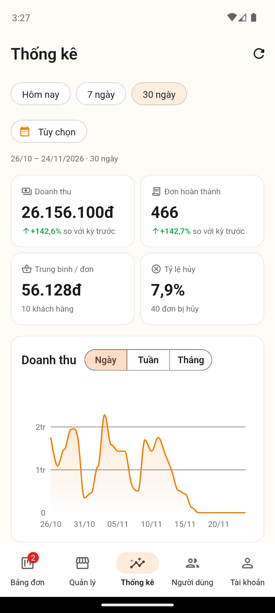

# Smart Canteen — ứng dụng Flutter

Ứng dụng đặt món căn-tin trường học. Một app dùng cho cả 3 vai trò:

- **Sinh viên:** xem thực đơn, đặt món, thanh toán tiền mặt hoặc chuyển khoản QR (payOS), theo dõi đơn realtime, xem lịch sử đơn cả khi mất mạng, đánh giá món.
- **Nhân viên căn-tin:** bảng đơn realtime, quản lý thực đơn / danh mục / voucher / đánh giá, xem thống kê doanh thu.
- **Quản trị viên:** toàn bộ chức năng của nhân viên, cộng thêm quản lý tài khoản (đổi vai trò, khóa / mở khóa).

App gọi REST API của backend ASP.NET Core (`../backend`), đăng nhập bằng Firebase Auth, nhận cập nhật trạng thái đơn qua Firebase Realtime Database và lưu dữ liệu trên máy bằng SQLite. Cách chạy backend xem [README gốc](../README.md).

<table>
  <tr>
    <td></td>
    <td></td>
    <td></td>
    <td></td>
    <td></td>
  </tr>
  <tr>
    <td align="center">Thực đơn</td>
    <td align="center">Chi tiết món</td>
    <td align="center">Theo dõi đơn (realtime)</td>
    <td align="center">Bảng đơn của nhân viên</td>
    <td align="center">Thống kê</td>
  </tr>
</table>

Toàn bộ 23 ảnh chụp màn hình (sáng, tối, màn ngang) nằm trong [`docs/screenshots`](../docs/screenshots).

## Mục lục

1. [Chạy app](#chạy-app)
2. [Tài khoản demo](#tài-khoản-demo)
3. [Đối chiếu yêu cầu đề bài](#đối-chiếu-yêu-cầu-đề-bài)
4. [Kiến trúc](#kiến-trúc)
5. [Kiểm thử](#kiểm-thử)
6. [Build APK và icon](#build-apk-và-icon)
7. [Xử lý sự cố](#xử-lý-sự-cố)

## Chạy app

Yêu cầu: Flutter 3.44+ (Dart 3.12+), Android SDK. Backend phải đang chạy trước (xem README gốc, mục *Chạy backend*).

### Trên máy ảo Android

```bash
cd mobile
flutter pub get
flutter run
```

App mặc định gọi `http://10.0.2.2:5265`. Đây là địa chỉ máy tính nhìn từ bên trong máy ảo Android, nên không cần cấu hình gì thêm.

### Trên điện thoại thật (cùng mạng Wi-Fi với máy tính)

1. **Lấy IP của máy tính:** chạy `ipconfig`, xem dòng *IPv4 Address* của card Wi-Fi (ví dụ `192.168.1.23`).
2. **Mở cổng 5265 trên tường lửa Windows** (PowerShell quyền Administrator, chỉ cần làm một lần):

   ```powershell
   New-NetFirewallRule -DisplayName "Smart Canteen API" -Direction Inbound -Protocol TCP -LocalPort 5265 -Action Allow -Profile Private
   ```

   Mạng Wi-Fi trên Windows phải đặt là *Private network*. Nếu đang là *Public*, đổi trong Settings → Network & Internet → Wi-Fi → (tên mạng).
3. **Chạy backend** như bình thường. Profile `http` đã lắng nghe trên mọi card mạng (`0.0.0.0:5265`).
4. **Cài APK** lên điện thoại: chép `build/app/outputs/flutter-apk/app-release.apk` sang máy và mở để cài (cho phép *Cài ứng dụng không rõ nguồn gốc*). Có thể dùng cáp USB: `adb install -r build/app/outputs/flutter-apk/app-release.apk`.
5. **Trỏ app tới máy tính:** ở màn Đăng nhập, bấm biểu tượng máy chủ ở góc trên bên phải → nhập `http://192.168.1.23:5265` → **Kiểm tra kết nối** → Lưu. Địa chỉ được lưu lại cho các lần mở sau.

   Cách khác: build sẵn địa chỉ vào APK bằng `flutter build apk --release --dart-define=API_BASE_URL=http://192.168.1.23:5265`.

## Tài khoản demo

Mật khẩu chung: `Canteen@123`

| Email | Vai trò | Dùng để demo |
|---|---|---|
| `sv01@smartcanteen.vn` | Sinh viên | Đặt món, thanh toán, theo dõi đơn, đánh giá |
| `sv02@smartcanteen.vn` | Sinh viên | Người đặt thứ hai (xem bảng đơn có nhiều khách) |
| `staff@smartcanteen.vn` | Nhân viên căn-tin | Bảng đơn, quản lý thực đơn, thống kê |
| `admin@smartcanteen.vn` | Quản trị viên | Thêm tab *Người dùng* |

Bản **debug** có nút chọn nhanh 3 tài khoản ở màn Đăng nhập. Bản **release** ẩn các nút này, phải nhập tay.

**Trước mỗi buổi demo**, chạy `scripts/demo-reset.ps1` ở thư mục gốc repo (xem [README gốc](../README.md#khởi-tạo-dữ-liệu-demo-chỉ-chạy-ở-môi-trường-development)). Script dọn đơn chạy thử, khôi phục thực đơn và voucher, và sinh lại 30 ngày lịch sử kết thúc ở hôm qua, để thống kê *7 ngày* luôn có số liệu. Thêm `-ClearApp` để xóa cả giỏ hàng và đăng nhập của app trên máy ảo.

## Đối chiếu yêu cầu đề bài

Đường dẫn trỏ thẳng tới file và dòng code.

### 1. Giao diện & responsive (2 điểm)

| Yêu cầu | Dùng ở đâu |
|---|---|
| Container, Column, Row, Card, ListTile | Mọi màn; ví dụ thẻ đơn [orders_screen.dart](lib/screens/orders/orders_screen.dart), tài khoản [account_screen.dart](lib/screens/profile/account_screen.dart) |
| `ListView.builder` | Giỏ hàng, lịch sử đơn, thông báo, danh sách người dùng [users_screen.dart](lib/screens/admin/users_screen.dart) |
| `GridView.builder` | Lưới món [menu_screen.dart:132](lib/screens/menu/menu_screen.dart#L132), menu quản lý [manage_hub_screen.dart](lib/screens/staff/manage_hub_screen.dart) |
| **LayoutBuilder** | Khung điều hướng: thanh dưới khi hẹp, NavigationRail khi rộng [responsive_shell.dart:44](lib/core/responsive/responsive_shell.dart#L44). Số cột lưới món 2→5 theo bề rộng [breakpoints.dart](lib/core/responsive/breakpoints.dart). Bảng đơn: 3 cột kanban khi rộng, 3 tab khi hẹp [order_board_screen.dart](lib/screens/staff/order_board_screen.dart). Thống kê: 4 thẻ một hàng và biểu đồ 2 cột [stats_screen.dart](lib/screens/staff/stats_screen.dart) |
| **MediaQuery** | Giới hạn cỡ chữ hệ thống [app.dart:35](lib/app.dart#L35), tránh bàn phím [auth_layout.dart:85](lib/screens/auth/widgets/auth_layout.dart#L85), ô lưới cao theo cỡ chữ [manage_hub_screen.dart](lib/screens/staff/manage_hub_screen.dart) |
| **OrientationBuilder** | Chi tiết món: ngang thì ảnh bên trái, nội dung bên phải [food_detail_screen.dart:175](lib/screens/menu/food_detail_screen.dart#L175). Theo dõi đơn: ngang thì mã nhận món bên trái, chi tiết bên phải [order_screen.dart:372](lib/screens/orders/order_screen.dart#L372) |
| **FittedBox** | Mã nhận món cỡ lớn, tổng tiền ở thanh toán [checkout_screen.dart:410](lib/screens/checkout/checkout_screen.dart#L410), số liệu thẻ thống kê, thống kê đơn của người dùng |
| **ThemeData Sáng/Tối** | [app_theme.dart](lib/core/theme/app_theme.dart) (Material 3, màu trạng thái đơn qua `ThemeExtension`). Chọn Sáng / Tối / Theo hệ thống ở Tài khoản [account_screen.dart:69](lib/screens/profile/account_screen.dart#L69), lựa chọn được lưu bằng `shared_preferences` [settings_provider.dart](lib/providers/settings_provider.dart) |
| StatefulWidget, TextEditingController, ScrollController | Mọi form (đăng nhập, hồ sơ, món, voucher). Cuộn vô hạn có phân trang API ở thực đơn [menu_screen.dart:26](lib/screens/menu/menu_screen.dart#L26) và người dùng [users_screen.dart:28](lib/screens/admin/users_screen.dart#L28) |
| Provider / ChangeNotifier | [app_providers.dart](lib/app_providers.dart): Settings, Auth, Menu, Cart, Orders, HomeTabs (`ChangeNotifierProxyProvider` đổi dữ liệu theo người đăng nhập) |
| Navigator, route có tên | `routes` + `onGenerateRoute` cho màn có tham số [app_routes.dart:65](lib/core/routes/app_routes.dart#L65); `Navigator.push(MaterialPageRoute)` cho màn phụ |

### 2. SQLite — CRUD (2 điểm)

[database_helper.dart](lib/data/local/database_helper.dart): `sqflite` + `path_provider`. Có 6 bảng, bật khóa ngoại (`PRAGMA foreign_keys = ON`) để xóa dây chuyền, có sẵn `onUpgrade` cho các phiên bản sau.

| Nhóm | Create | Read | Update | Delete |
|---|---|---|---|---|
| Giỏ hàng (`cart_items`, `cart_item_options`) — [cart_dao.dart](lib/data/local/cart_dao.dart) | `add` (gộp món trùng) | `getItems`: khôi phục giỏ khi mở lại app, riêng từng tài khoản | `updateQuantity`, `updateNote` | `remove`, `clear` sau khi đặt |
| Hóa đơn (`orders`, `order_items`, `order_item_options`) — [order_dao.dart](lib/data/local/order_dao.dart) | `upsertDetail` khi đặt món | `getOrders`, `getOrder`: **lịch sử đơn khi mất mạng** | `updateStatus` khi nhận cập nhật realtime | `delete`, `deleteAll` |
| Lịch sử tìm kiếm (`search_history`) — [search_history_dao.dart](lib/data/local/search_history_dao.dart) | `add` | `recent`: gợi ý ở ô tìm | `add` lại thì làm mới thời điểm | `remove`, `clear` |

**Demo:** tắt mạng máy ảo → tab Đơn hàng vẫn hiện đầy đủ, kèm banner "Không có mạng — đang xem hóa đơn đã lưu trên máy".

### 3. Firebase Auth + Realtime Database (2,5 điểm)

| Yêu cầu | Dùng ở đâu |
|---|---|
| Đăng ký / đăng nhập / quên mật khẩu bằng email | [auth_service.dart](lib/data/firebase/auth_service.dart), các màn trong [screens/auth](lib/screens/auth) |
| **`authStateChanges()`** | Stream `async*` [auth_service.dart:54](lib/data/firebase/auth_service.dart#L54); **AuthGate** dùng `StreamBuilder` để chọn màn: Đăng nhập / Hoàn tất hồ sơ / Tài khoản bị khóa / app theo vai trò [auth_gate.dart:42](lib/screens/auth/auth_gate.dart#L42) |
| **Stream `async*` / `yield`** | [realtime_service.dart](lib/data/firebase/realtime_service.dart): `watchOrder`, `watchMyOrders`, `watchNotifications`, `watchBoard`. Dùng `yield*` để listener của Firebase bị hủy ngay khi màn hình thôi nghe (không còn lỗi `permission-denied` khi đăng xuất) |
| **StreamBuilder** | Theo dõi đơn [order_screen.dart:258](lib/screens/orders/order_screen.dart#L258), bảng đơn của nhân viên, thông báo [notifications_screen.dart:67](lib/screens/notifications/notifications_screen.dart#L67), badge số chưa đọc [home_shell.dart:41](lib/screens/home/home_shell.dart#L41), badge số đơn mới của nhân viên |
| Phân quyền | Token mang claim `role` → Security Rules: sinh viên chỉ đọc đơn của mình, nhân viên đọc toàn bộ đơn (`../firebase/database.rules.json`) |

**Demo:** sinh viên mở màn theo dõi đơn, nhân viên bấm "Bắt đầu nấu" trên máy khác (hoặc gọi API) → màn của sinh viên tự chuyển bước và hiện thông báo.

### 4. REST API & bất đồng bộ (2 điểm)

| Yêu cầu | Dùng ở đâu |
|---|---|
| GET / POST / PUT / PATCH / DELETE | [api_client.dart:43-52](lib/data/remote/api_client.dart#L43-L52); mỗi module có một file `*_api.dart` trong [data/remote](lib/data/remote) |
| **`jsonDecode`** | [api_client.dart:145](lib/data/remote/api_client.dart#L145); lỗi ProblemDetails → `ApiException(code, message, fieldErrors)` |
| **FutureBuilder + ConnectionState** | Widget dùng chung [async_value_view.dart](lib/widgets/async_value_view.dart) (đủ `none/waiting/active/done` + lỗi + rỗng). Báo giá ở Thanh toán [checkout_screen.dart:177](lib/screens/checkout/checkout_screen.dart#L177), đánh giá món [food_detail_screen.dart:514](lib/screens/menu/food_detail_screen.dart#L514), thống kê (khi tải lại vẫn giữ số cũ, hiện mờ) [stats_screen.dart](lib/screens/staff/stats_screen.dart), chi tiết tài khoản [user_detail_screen.dart](lib/screens/admin/user_detail_screen.dart). Future luôn được tạo trong `initState` hoặc provider, không tạo trong `build` |
| Thực tế hơn mức tối thiểu | Header `Idempotency-Key` (mất mạng bấm lại không tạo đơn trùng), `rowVersion` chống ghi đè khi 2 người cùng sửa (409), tải song song bằng `Future.wait`, cập nhật lạc quan (đổi giao diện trước, lỗi thì hoàn tác), upload ảnh multipart |

## Kiến trúc

```
lib/
├── main.dart, app.dart, app_providers.dart   khởi tạo Firebase/SQLite, MaterialApp, danh sách Provider
├── core/          theme (màu, token khoảng cách), responsive (breakpoint, khung điều hướng), routes, utils (tiền, giờ VN)
├── models/        model + fromJson (enum camelCase, thời gian UTC → giờ Việt Nam khi hiển thị)
├── data/
│   ├── remote/    ApiClient (http + jsonDecode + token) và các *_api.dart theo module
│   ├── firebase/  AuthService, RealtimeService (Stream async*)
│   ├── local/     DatabaseHelper + DAO (sqflite)
│   └── device/    chọn ảnh (image_picker)
├── providers/     Settings, Auth, Menu, Cart, Orders, HomeTabs (ChangeNotifier)
├── screens/       auth, menu, cart, checkout, orders, notifications, profile, reviews, staff, admin
└── widgets/       widget dùng chung: trạng thái tải/lỗi/rỗng, thẻ món, chip trạng thái...
```

- **Luồng dữ liệu:** màn hình → Provider → `*_api.dart` / DAO / RealtimeService. Mọi lớp dữ liệu đều có interface, nên test thay được bằng bản giả.
- **Phiên đăng nhập:** `AuthProvider` nghe `authStateChanges`, rồi gọi `GET /api/users/me` để lấy vai trò. Các provider khác tự làm mới dữ liệu khi người đăng nhập thay đổi.
- **Thời gian:** backend trả UTC; app luôn hiển thị theo giờ Việt Nam cố định, không phụ thuộc múi giờ của điện thoại.

## Kiểm thử

```bash
flutter analyze   # không có cảnh báo
flutter test      # 188 test, khoảng 45 giây
```

Test dựng **toàn bộ app thật** (đúng danh sách Provider như `main.dart`), chỉ thay các phần nằm ngoài app bằng bản giả: Firebase Auth/RTDB, backend (`MockClient` trả JSON giống backend thật), SQLite (bản trong bộ nhớ; riêng test DAO dùng `sqflite_common_ffi` với SQLite thật).

| Nhóm | Nội dung |
|---|---|
| `test/data` | DAO SQLite: đủ CRUD cả 6 bảng, xóa dây chuyền, gộp món trùng. ApiClient: gắn token, đọc lỗi ProblemDetails, timeout |
| `test/core` | Model `fromJson`, định dạng tiền, giờ VN, báo giá, khung giờ nhận món, Idempotency-Key, model thống kê |
| `test/providers` | Đăng nhập/đăng xuất, giỏ hàng còn nguyên sau khi mở lại app, lịch sử đơn khi mất mạng, cập nhật realtime ghi vào SQLite |
| `test/screens/*_flow_test` | Từng luồng qua giao diện: đăng ký, đặt món, thanh toán QR, theo dõi đơn, đánh giá, bảng đơn (cả xung đột 409), quản lý món/voucher, thống kê, quản trị người dùng |
| `test/screens/responsive_sweep_test` | Mở mọi tab của 3 vai trò ở 5 kích thước (320×640 chữ 130%, điện thoại ngang, tablet dọc/ngang, màn rộng), xen kẽ sáng/tối. Có chỗ tràn bố cục là test hỏng |

## Build APK và icon

```bash
flutter build apk --release                  # 1 file chạy mọi máy (~62 MB)
flutter build apk --release --split-per-abi  # tách theo CPU; điện thoại hiện nay dùng app-arm64-v8a-release.apk (nhỏ hơn nhiều)
```

- **Ký APK:** bản demo ký bằng debug key (cấu hình trong `android/app/build.gradle.kts`), nên cài thẳng được, không cần keystore.
- **Icon và màn chờ:** logo được vẽ bằng script [tool/make_icon.py](tool/make_icon.py), ảnh xuất ra nằm ở `assets/branding/`. Sinh lại bằng:

  ```bash
  python tool/make_icon.py assets/branding
  dart run flutter_launcher_icons
  dart run flutter_native_splash:create
  ```

## Xử lý sự cố

| Hiện tượng | Cách xử lý |
|---|---|
| "Không kết nối được máy chủ" trên máy ảo | Kiểm tra backend đang chạy (`http://localhost:5265/api/health`). Địa chỉ trong app phải là `http://10.0.2.2:5265` |
| Điện thoại thật không kết nối được | Điện thoại và máy tính cùng một mạng Wi-Fi; đã mở cổng 5265; mạng Windows là *Private*. Thử mở `http://<IP>:5265/api/health` bằng trình duyệt trên điện thoại |
| Đặt món báo "Căn-tin chỉ nhận đơn từ … đến …" | Giờ mở cửa cấu hình ở `appsettings.json` của backend. Khi thử ngoài giờ, chạy backend với `Canteen__CloseTime=23:59` |
| Thống kê "7 ngày" trống, voucher hết hạn, bảng đơn còn đơn cũ, sinh viên không đặt thêm được | Dữ liệu demo đã cũ: chạy `scripts/demo-reset.ps1` |
| Nhân viên không thấy bảng đơn | Đăng xuất rồi đăng nhập lại để token nhận claim `role` mới (cần cho Security Rules) |
